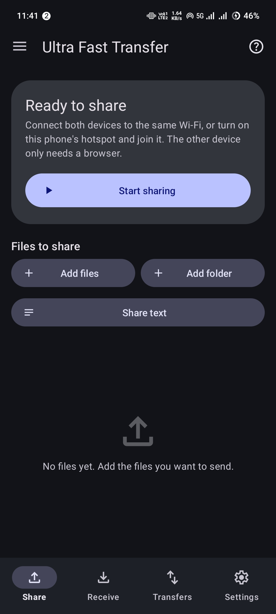
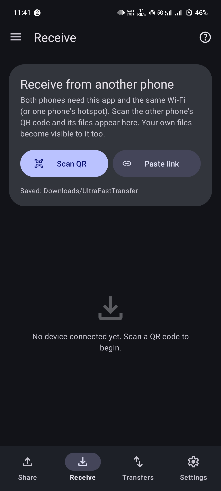
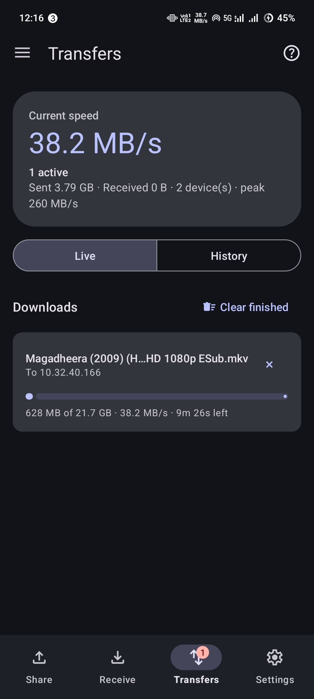
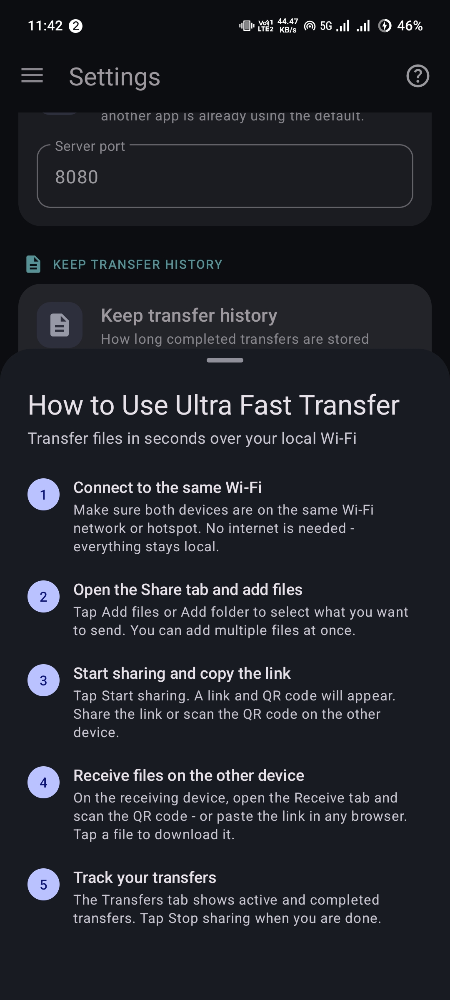
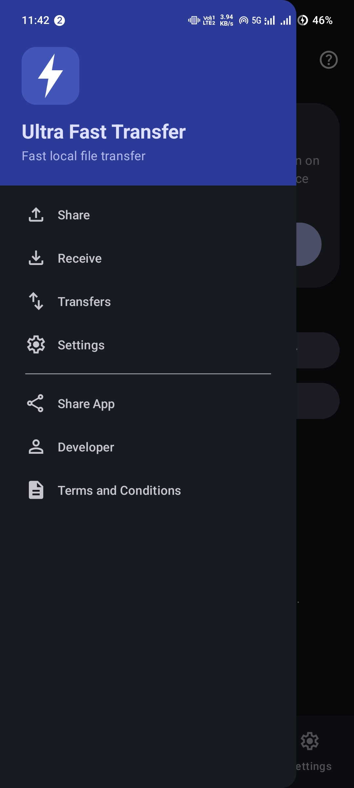

  

  <h1>Ultra Fast Transfer</h1>

  
<strong>Send files from Android to almost any device over local Wi-Fi.</strong>

  

    Transfer files to a Mac, iPhone, iPad, Windows PC, Linux computer, Chromebook, or another device with a browser.
    The receiving device does not need to install Ultra Fast Transfer.
  

  

    
    
    
  

  

    <a href="https://github.com/AbhiTheNullPointer/UltraFastTransfer/releases/download/v1.0.0/UltraFastTransfer-release1.0.0.apk">Download APK (v1.0.0)</a>
    &nbsp;&middot;&nbsp;
    <a href="#features">Features</a>
    &nbsp;&middot;&nbsp;
    <a href="#screenshots">Screenshots</a>
    &nbsp;&middot;&nbsp;
    <a href="#how-it-works">How it works</a>
  

---

## Transfer speed

Transfers can reach **42 MB/s (about 336 Mbps)** on a fast local Wi-Fi connection. Actual speeds depend on the Wi-Fi network, distance, and both devices. The transfer stays on your local network; an internet connection is not required.

## Features

- **Android to any browser** - Send from your Android phone to a Mac, iPhone or iPad, Windows PC, Linux computer, Chromebook, or another device with a modern browser.
- **No receiver app required** - The other device opens the local link in its browser and downloads the shared files.
- **Fast local transfers** - Send directly over the same Wi-Fi network or an Android hotspot, without a cloud relay.
- **QR code and local link** - Let the receiving device scan the code or open the address shown in the app.
- **Files, folders, and text** - Share individual files, whole folders, or a text snippet.
- **Bulk downloads** - Download shared files individually or together as a ZIP.
- **Free to use** - No account is required.

## How it works

1. Connect the Android phone and receiving device to the same Wi-Fi, or connect the other device to the phone's hotspot.
2. Open Ultra Fast Transfer on Android and select files, a folder, or text to share.
3. Tap **Start Sharing**. The app shows a local link and QR code.
4. On the other device, scan the QR code or open the link in a browser. **No app installation is needed on the receiving device.**
5. Download the shared files from the browser.

## Screenshots

<table>
  <tr>
    <td align="center" width="20%">
      
       
      <strong>1. Share files</strong>
    </td>
    <td align="center" width="20%">
      
       
      <strong>2. Receive</strong>
    </td>
    <td align="center" width="20%">
      
       
      <strong>3. Transfer activity</strong>
    </td>
    <td align="center" width="20%">
      
       
      <strong>4. Quick guide</strong>
    </td>
    <td align="center" width="20%">
      
       
      <strong>5. Navigation</strong>
    </td>
  </tr>
</table>

## Download and install

1. Download [UltraFastTransfer-release1.0.0.apk](https://github.com/AbhiTheNullPointer/UltraFastTransfer/releases/download/v1.0.0/UltraFastTransfer-release1.0.0.apk), or choose a version from [GitHub Releases](https://github.com/AbhiTheNullPointer/UltraFastTransfer/releases).
2. Open the APK on your Android device (Android 7.0 or later).
3. Follow Android's prompts to install it.

> This repository contains the app website and release links. The Android app source code is not published here.

## Developer

Built by [Abhinandan Kumar (@AbhiTheNullPointer)](https://github.com/AbhiTheNullPointer).

&copy; 2026 Ultra Fast Transfer. All rights reserved.
